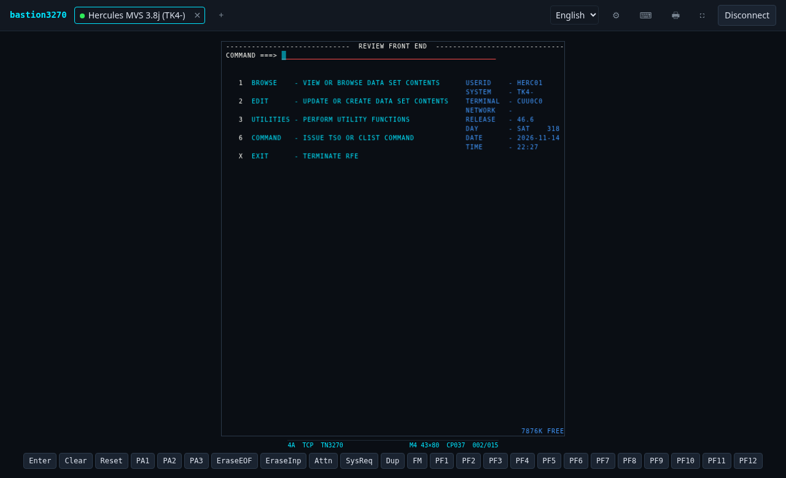
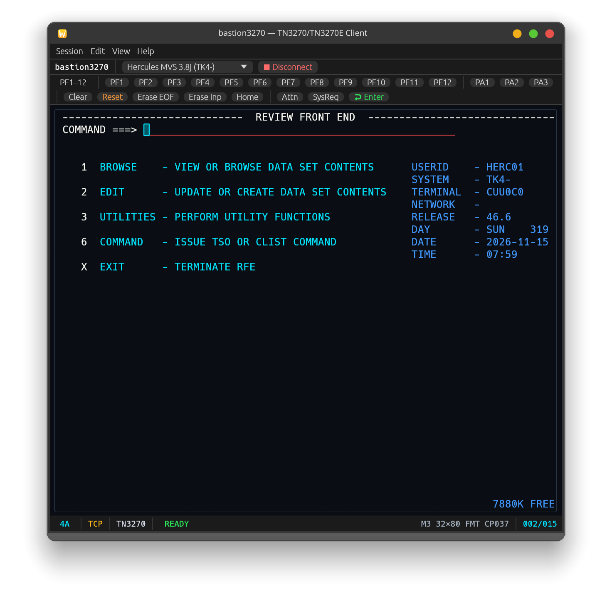
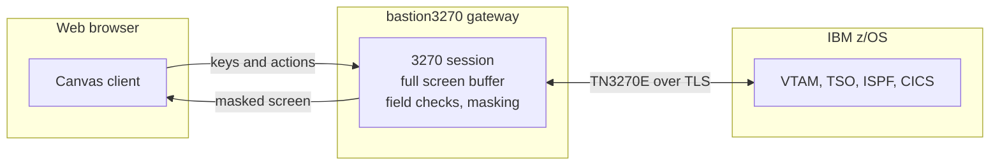

# bastion3270

[](https://github.com/tom-danek/bastion3270/actions/workflows/ci.yml)
[](LICENSE)
[](https://github.com/tom-danek/bastion3270/releases)

> **Security-first TN3270 access to the mainframe — closing the gaps TN3270 leaves open.**

* **Hidden field contents are never sent to the browser.** The gateway runs the session and
  sends a masked screen, so a password typed into the page is not shown, copied, printed or
  kept there. Protected and numeric fields are enforced in the gateway, not trusted to the
  client.
* **TLS that actually connects.** Host certificates are checked against the operating system's
  and your own certificate authorities, with the name rules z/OS certificates need, so
  encryption is not switched off just because a bank's CA was not deployed.
* **The gateway decides which hosts are reachable,** and audits every session.
* **A hostile or broken data stream cannot crash or take over the client.** The protocol is
  parsed in memory-safe Rust without `unsafe` code, fuzzed and property-tested.

bastion3270 is a memory-safe TN3270 / TN3270E
implementation written in Rust. It is meant for everyone who wants to replace old desktop 3270
emulators, whether with a browser tab that is centrally run, audited and safe to expose, or
with a modern native client.

The project contains two products built on one common, secure core:

* **Web gateway** (`bastion3270-server`): runs the 3270 sessions in the data centre and serves
  them to a thin browser client. Nothing to install on workstations; the gateway decides who
  reaches which host, audits every session, and the contents of hidden fields are never sent
  to the browser.
* **Desktop client** (`bastion3270-gui`): a native application for **all common operating
  systems — Windows, macOS and Linux** — with the same look and behaviour on each, for users
  who connect directly to the host.
* **Common core** (`bastion3270-core`, `bastion3270-net`): the 3270 data stream, TN3270E and
  TLS. Both products behave the same way, share the same keyboard layouts and get the same
  fixes and tests.





> **Status: pre-1.0.** The protocol core, the web gateway and the desktop client are tested
> extensively — against the Hercules MVS 3.8j emulator and with z/OS data streams in the
> regression tests — but the configuration and the WebSocket protocol may still change between
> minor versions. See the [changelog](CHANGELOG.md).

## Try it in five minutes

You need Git and [Podman](https://podman.io/) with `podman-compose`, or Docker with Docker
Compose. The stack builds the gateway and starts a local
[Hercules](https://sdl-hercules-390.github.io/html/) emulator with the free MVS 3.8j
"TK4-" system.

```bash
git clone https://github.com/tom-danek/bastion3270.git
cd bastion3270
podman-compose -f docker/docker-compose.yml up -d --build    # or: docker compose -f … up -d --build
```

The first build takes a few minutes. Then:

1. Open <http://127.0.0.1:8080>. The demo offers one system, **Hercules MVS 3.8j (TK4-)**, so
   the client connects to it at once.
2. MVS needs about a minute to start after the container. The first connection to a terminal
   shows the TK4- logo with the Hercules version: press **Clear** on the key bar under the
   screen, as the TK4- manual asks, and the logon screen appears.
3. At `Logon ===>` type `HERC01` and press Enter.
4. Enter the password `CUL8TR` (it is not shown, and the gateway never sends it back to the
   page), then press Enter until the menu appears.

The same emulator also serves the desktop client: start it from a
[release](https://github.com/tom-danek/bastion3270/releases) or with
`cargo run --release -p bastion3270-gui`, and connect with its built-in profile
**Hercules MVS 3.8j (TK4-)**.

The [user guide](docs/USER_GUIDE.md) explains the screen and the keys. Stop the stack with
`podman-compose -f docker/docker-compose.yml down`.

## Why

**The common core**

* **Memory-safe and panic-free.** No `unsafe` code; a malformed packet from the network ends
  with a typed error, never with a crash. Parsers are fuzzed and property-tested.
* **Behaves like x3270.** Keyboard, field and protocol behaviour follow the x3270 reference
  implementation, so mainframe applications work as users expect.
* **TLS that works with bank PKI.** Host certificates are checked against the operating
  system's and the administrator's certificate authorities, with the name rules z/OS
  certificates need; optional client certificates (mutual TLS).

**The web gateway**

* **Hidden fields stay hidden.** The 3270 session runs only in the gateway. The browser
  receives a masked projection of the screen; content of non-display fields (passwords) never
  leaves the protocol core — not to the browser, not to logs.
* **The gateway decides where sessions go.** Users pick a profile of the administrator, or
  define a connection of their own that the gateway checks against its policy (on by default;
  restrict it to an allow-list of targets, require TLS or switch it off).
* **Built for a data centre.** Thousands of sessions per process, limits against denial of
  service, structured audit log, Prometheus metrics, health and readiness probes, a minimal
  non-root container image and Kubernetes manifests.

**The desktop client**

* **Windows, macOS and Linux alike.** One code base and the same behaviour on every common
  operating system; builds for all three come with each release.
* **One small native program** without a runtime to install, with profiles that can be shared
  by a team, and a clear dialog when a host certificate is not trusted.

## How it works



* **Browser → gateway:** keys, pasted text, cursor moves and function keys. Never field
  contents: the gateway checks every input against the field attributes (protected, numeric)
  as a terminal would.
* **Gateway → browser:** the screen with every non-display field blanked, the status line and
  messages.
* **Gateway → mainframe:** TN3270E over TLS 1.2 / 1.3, trusting the operating system's and the
  administrator's certificate authorities; optional client certificates (mutual TLS).

Details are in the [architecture](docs/ARCHITECTURE.md).

## Features

* **Web client:** several sessions in tabs, survives a reload or a network drop, copy / paste /
  print following the policy of each system, x3270 or IBM Personal Communications key layout,
  colour themes, English and Czech; can be installed as an application from the browser.
* **Terminal:** TN3270 and TN3270E, models 2–5 and custom sizes up to 62 × 160, 3270 extended
  attributes and colours, SSCP-LU mode (VTAM logon screens), 35 EBCDIC code pages.
* **Gateway:** profiles with per-profile LU names and options, user-defined connections under a
  policy, bearer-token authentication, audit log in JSON, Prometheus metrics, graceful
  shutdown that lets users reconnect.
* **Operations:** one static binary, a non-root container image, Kubernetes manifests with the
  Gateway API, a configuration checker (`--check-config`).
* **Desktop client:** the same core in a native window, with profiles, the same key layouts and
  a dialog for trusting a host certificate.

## Compared with the usual alternatives

| | Desktop emulator | Emulator in the browser | bastion3270 |
| :--- | :--- | :--- | :--- |
| Installed on every workstation | yes | no | no |
| 3270 protocol runs in | the workstation | the browser | the gateway |
| Hidden field contents reach the user's device | yes | yes | no |
| Which hosts a user may reach | workstation network | browser / proxy | gateway policy |
| Central audit of sessions | no | depends | yes |

## Download

Builds of the desktop client for Linux (x86_64), Windows (x86_64) and macOS (Apple Silicon) are
attached to each [release](https://github.com/tom-danek/bastion3270/releases), with a
`SHA256SUMS` file. The builds are not code-signed yet, so Windows SmartScreen and macOS
Gatekeeper warn on first start.

## Build from source

```bash
cargo build --release
cargo test

cargo run --release -p bastion3270-gui        # desktop client
cargo run --release -p bastion3270-server -- --config gateway.toml
                                              # gateway, see the configuration reference
```

Kubernetes manifests (Gateway API) are in `deploy/k8s/`; see the
[operations guide](docs/OPERATIONS.md).

| Crate | Description |
| :--- | :--- |
| `bastion3270-core` | 3270 data stream, Telnet/TN3270E, EBCDIC code pages, presentation space and `SafeScreenView` (hidden fields never leave the core). |
| `bastion3270-net` | Async TCP and TLS 1.2/1.3 transport and session handling. |
| `bastion3270-gui` | Native desktop client for Windows, Linux and macOS (`egui`). |
| `bastion3270-server` | Web gateway: runs the 3270 session on the server and serves a thin HTML5 canvas client over WebSocket. |
| `bastion3270-loadgen` | Load and soak tests of the gateway with simulated hosts and browsers (development tool). |

## Desktop client files

The desktop client keeps its profiles in a per-user file, edited in its profile manager, and
writes a diagnostics log (the previous run's log is kept as `.1`). `bastion3270-gui --profiles <file>` uses another profile file, e.g.
one shared by a team. The level of the log is set with `RUST_LOG` (default `warn`).

| Platform | Profiles | Log |
| :--- | :--- | :--- |
| Linux | `~/.config/bastion3270/profiles.toml` (`$XDG_CONFIG_HOME`) | `~/.local/state/bastion3270/` (`$XDG_STATE_HOME`) |
| Windows | `%APPDATA%\bastion3270\profiles.toml` | `%LOCALAPPDATA%\bastion3270\logs\` |
| macOS | `~/Library/Application Support/bastion3270/profiles.toml` | `~/Library/Logs/bastion3270/` |

An invalid profile file is never overwritten: it is renamed to `profiles.toml.invalid-<time>`
and the client starts with its built-in profiles.

## Status and roadmap

Working today: everything listed under [Features](#features), tested with Hercules MVS 3.8j
and z/OS data streams, and with load tests of thousands of sessions per gateway process.

Next:

* signed desktop builds and installers;
* a published container image with an SBOM;
* more code pages and keyboard layouts on request.

Ideas and requests are welcome as [issues](https://github.com/tom-danek/bastion3270/issues).

## Documentation

* [User guide](docs/USER_GUIDE.md) — working with the web client, status line, keyboard
  reference for the web and desktop clients.
* [Configuration reference](docs/CONFIGURATION.md) — every setting of the gateway and the
  desktop client, with defaults.
* [Operations guide](docs/OPERATIONS.md) — deploying on Kubernetes, configuration changes,
  upgrades, token rotation, monitoring, troubleshooting.
* [Architecture](docs/ARCHITECTURE.md) — crates, Zero-Trust security model, web gateway design.
* [Development guide](docs/DEVELOPMENT.md) — toolchain, engineering standards, local Hercules,
  running and testing the gateway.
* [Changelog](CHANGELOG.md).

## How it is made

bastion3270 is developed by one author in their spare time, together with an AI coding
assistant (Claude Code). The author decides the design and reviews every change; all code,
whoever wrote it, follows the same engineering standards: no `unsafe`, no panics in production
code, behaviour that follows x3270 and the RFCs, and a regression test for every fix.

## Contributing and security

Bug reports and feature requests are welcome as issues; pull requests are not accepted yet —
see [CONTRIBUTING.md](CONTRIBUTING.md). Please report security problems privately as described
in [SECURITY.md](SECURITY.md).

## License

Licensed under the Apache License, Version 2.0 — see `LICENSE` and `NOTICE`. Third-party
notices (x3270) are in `THIRD_PARTY_NOTICES`.
