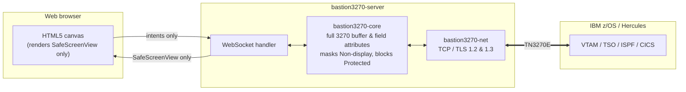

# Architecture

`bastion3270` is a memory-safe **TN3270 / TN3270E client** for **IBM z/OS** (and the Hercules
emulator) with two deployment modes:

1. **Web gateway** (`bastion3270-server`) in Kubernetes or a container, serving a thin browser client.
   This is the primary way to use `bastion3270`.
2. **Native desktop client** (`bastion3270-gui`) for Windows, Linux and macOS.

---

## 1. Workspace layout

| Crate | Purpose | OS / network dependencies |
| :--- | :--- | :--- |
| `bastion3270-core` | Pure protocol logic: EBCDIC code pages, Telnet/TN3270E state machine, 3270 data stream parser, structured fields and query replies, `PresentationSpace`, `SafeScreenView`, virtual keyboard and AID handling. | None — deterministic and fully unit-testable. |
| `bastion3270-net` | Asynchronous transport (`tokio`, `rustls` with `ring`) to z/OS (TLS 1.2 / 1.3) and Hercules (plain TCP); connection profiles; `SessionCoordinator` actor. | `tokio`, `rustls` |
| `bastion3270-server` | Library and binary: server-side session management, WebSocket API `bastion3270.v1`, HTML5 canvas client, extension traits. | `axum`, `async-trait` |
| `bastion3270-gui` | Native client on `egui` / `eframe`, using `bastion3270-core` + `bastion3270-net` directly. | `eframe`, `egui` |
| `bastion3270-loadgen` | Load and soak tests of the gateway: simulated hosts and browsers (development tool, not shipped). | `tokio`, `rustls` |

The protocol implementation is a Rust rewrite guided by the `x3270` reference code (`ctlr.c`,
`sf.c`, `telnet.c`, `kybd.c`, `unicode.c`); see `THIRD_PARTY_NOTICES`.

---

## 2. Security model: Zero-Trust client (`SafeScreenView`)

Mainframe applications (CICS, COBOL, ISPF) rely on the terminal to protect fields: protected fields
must not be overwritten and non-display fields (passwords) must not be shown. A browser is fully
under the user's control, so none of this may be enforced in the browser.

1. In web mode the complete `bastion3270-core` state machine runs **only in the gateway**.
2. **Non-display fields:** the core never exports the raw 3270 buffer. It exports a
   `SafeScreenView`, in which every character of a `Non-display` field is replaced by a space
   before it leaves the core — also towards logs and extensions.
3. **Protected and numeric fields:** the browser never sends field contents, only intents
   (key, text, action, cursor move, AID, Attn/SysReq). The core validates every input against
   the field attributes; a write into a protected field is rejected and locks the keyboard
   (`X PROTECTED`).



---

## 3. Key design decisions

1. **Screen models:** Model 2 (24×80), 3 (32×80), 4 (43×80), 5 (27×132) and `IBM-DYNAMIC`
   (custom sizes up to the 14-bit address limit of 16 383 cells).
2. **Code pages:** pluggable `CodePage` interface; built in: every single-byte host code page of
   x3270 (35, e.g. `CP037`, `CP1047`, the euro pages `CP1140`–`CP1149`, `CP870`), generated
   from the x3270 tables. APL / Graphic Escape characters (CP310, e.g. ISPF box drawing) are
   rendered from their own table.
3. **Targets decided by the gateway:** a browser user opens profiles defined by the administrator,
   or a connection of their own (host, port, TLS) that the gateway checks against its
   `[custom_connections]` policy before anything connects. Custom connections are enabled by
   default and then reach any host and port from the gateway's network position (SSRF risk,
   warned at startup); the administrator restricts them to an allow-list of hosts, domains,
   address ranges and ports, requires TLS, or switches them off. Profile connection settings are
   never sent to the browser. Every
   profile states its `tls_mode`: there is no default, so a forgotten setting never means clear
   text. With TLS the gateway verifies the host's server certificate; only if the host also
   requires client authentication (e.g. AT-TLS) does a profile add a client certificate
   (optional mutual TLS).
4. **Tab-independent sessions:** a session lives in the gateway and survives a browser refresh or
   a short network outage; resuming requires the session id and a one-time resume token.
5. **Unified configuration:** TOML (desktop profiles, gateway config / Kubernetes `ConfigMap`)
   for the same connection settings; unknown keys are rejected. The gateway takes only its
   configuration path and listen address from the environment (`BASTION3270_SERVER_CONFIG`,
   `BASTION3270_SERVER_BIND`); see `docs/CONFIGURATION.md`.
6. **Session modes:** like x3270, the client follows the host mode record by record: 3270 data
   stream, SSCP-LU data (unformatted text such as the VTAM USS logon screen; Enter sends the
   typed line) and NVT data. NVT text is shown as a banner only; there is no NVT/ANSI terminal
   emulation, and the keyboard reports `X -f` in NVT mode. Screen sizes requested by a BIND are
   used when they lie between 24×80 and the model size.
7. **Trusted host certificates:** banks run their own CAs, so a certificate is trusted if it
   leads to any of: the Mozilla roots, the operating system's certificate store, the gateway's
   `[host_tls] ca_certs` (for every profile and custom connection) and the profile's `ca_cert`
   (a CA file may also hold an intermediate the host does not send). The chain is always
   verified; the name is then checked like x3270 (`sio_openssl.c`): against `accept_hostname`
   if set, else the host, and a certificate without subject alternative names by its common
   name (z/OS certificates created without `ALTNAME`). A refused certificate is reported with
   the reason, subject, issuer, validity, names and SHA-256 — in the gateway's audit record,
   never to the browser. The desktop client may trust one exact certificate per profile
   (`pinned_cert_sha256`, after the user compared its fingerprint); the gateway refuses that
   setting, so there only the administrator decides.

---

## 4. Web gateway

### 4.1 Protocol `bastion3270.v1`
JSON over WebSocket. The browser sends only intents (`key`, `text`, `action`, `move_cursor`, `aid`,
`attention`); the gateway sends the `SafeScreenView` projection (text rows + run-length encoded
style runs) and the status line. Unknown message fields are rejected (`deny_unknown_fields`), so an attempt to
inject `host` / `port` ends with `bad_request`. With `open` the browser may send the user's session
choices (`options`: terminal model, a dynamic screen between 24 × 80 and 62 × 160, code page,
LU name — an SNA name, within the profile's `allowed_lu_names` if the administrator set them —
and the initial blank fill; numeric lock stays the profile's); the gateway applies them to a copy of the profile and validates the
result before anything connects (`invalid_options` otherwise). Host, port, TLS and the profile's
policies are never among them; a connection of the user's own is a separate message
(`open_custom` with `target`: host, port, TLS) checked against `[custom_connections]` and audited
with the profile id `custom:<host>:<port>`. Blank fill can also be switched during a session
(`blank_fill`), as an operator preference. Before the gateway closes the WebSocket it sends
`closed` with a reason from a fixed set: `user`, `host_disconnected`, `taken_over`,
`server_shutdown`, `rate_limited`, and when it ends the session itself `idle`, `lifetime`,
`identity_expired` or `ended`.

### 4.2 Session lifecycle
`GatewaySession` is independent of the browser tab. A refresh only detaches the browser; resuming
needs `session_id` + `resume_token` (256 random bits; only its SHA-256 is stored, compared in
constant time). Every resume issues a new token, so each token works once. A reaper closes a session
that is detached longer than `detach_grace_secs`, has had no operator input for `idle_timeout_secs`,
is older than `max_session_lifetime_secs`, or whose identity expired (`SessionIdentity::expires_at`);
a custom binary can also end all sessions of one identity (`Gateway::close_sessions_for`). Opening
the same session from a second tab takes it over. The latest screen is published through
`tokio::sync::watch`, so a slow browser skips intermediate screens instead of queueing them
(constant memory per session).

### 4.3 Limits (DoS)
`max_sessions` per gateway, `max_sessions_per_identity` (RAII slot released on `Drop`; not applied
without authentication, where all users share one identity), maximum WebSocket message size,
maximum paste length and a message rate limit (control frames included). Connections are bounded
too: `max_connections`, `max_pending_handshakes`, a header read timeout against slow clients and a
liveness check of the browser. Towards the host every step has a deadline: connect, Telnet
negotiation, each write and host silence.

### 4.4 Browser security
Strict CSP (no inline scripts), `X-Frame-Options: DENY`, `Cross-Origin-Opener-Policy`,
`Cross-Origin-Resource-Policy`, `Permissions-Policy`, `Origin` check against cross-site WebSocket
hijacking. Browsers can install the client as an application from its manifest and icons; there
is deliberately no service worker, so no code or screen data is kept in the browser and every
response stays `no-store`. Error texts sent to the browser are fixed; details (host names, certificate names, file
paths) stay in the audit record. Behind an ingress, `server.trusted_proxies` names the proxies
whose `X-Forwarded-For` / `X-Forwarded-Proto` are believed: the audit then records the browser's
address, and the same-origin check also compares the scheme. The proxy must set
`X-Forwarded-Proto` itself (overwrite or append); its last value is used. Failure records (wrong token, wrong
origin, refused messages) are capped per source and minute; the rest is reported as one summary.
A bearer token from the browser is sent as the sub-protocol
`bastion3270.bearer.<token>`, because the WebSocket API cannot set an `Authorization` header.

### 4.5 Extension traits
Deployment-specific behaviour is behind object-safe traits with default implementations
(`Extensions::defaults()`):

| Trait | Default implementation |
| :--- | :--- |
| `AuthProvider` | `NoAuthProvider` (logon on the mainframe screen), `StaticTokenProvider` (bearer tokens, only SHA-256 hashes in the config) |
| ↳ `resolve_mainframe_credentials` | `Ok(None)`; an implementation may return a server-side `MainframeAutoLogon` script |
| `AuditSink` | `StdoutAuditSink` — structured log (who, when, where, AID, SHA-256 of the masked screen) |
| `DlpPolicy` | `StaticDlpPolicy` — per-profile `allow_paste` / `allow_copy` (copy also decides printing) |
| `SessionStore` | `InMemorySessionStore` — sessions in the memory of one gateway instance |

Traits are used as `Arc<dyn Trait>` (one indirection per call, negligible next to the mainframe
round trip) instead of generic parameters that would leak into every public type; async methods use
`#[async_trait]` because native `async fn` in traits is not dyn-compatible. No extension ever
receives the raw presentation space — only `SafeScreenView`. A custom binary depends on the library
and swaps implementations:

```rust
let extensions = Extensions::defaults(&config)
    .with_audit(Arc::new(MyAuditSink::new(..)));
Server::new(config, extensions).serve(shutdown).await
```

### 4.6 Container and Kubernetes
Static musl binary in a `scratch` image (under 10 MB), non-root UID 65532, read-only root filesystem,
no configuration in the image (it is mounted; without one the gateway does not start),
`--healthcheck` built into the binary, `/healthz` and `/readyz` (503 while draining on SIGTERM),
`NetworkPolicy` as a second line of defence against SSRF. TLS usually ends at the ingress; with
`[server.tls]` the gateway serves HTTPS itself, optionally requiring a client certificate from the
ingress (mutual TLS). Prometheus metrics on a separate listener (`server.metrics_bind`, example
Grafana dashboard in `deploy/grafana/`). Manifests: `deploy/k8s/` (Gateway API for TLS
termination, any conformant controller). On SIGTERM the gateway refuses new sessions, closes
the existing ones and waits until every browser was told (`server_shutdown`) before it exits.

Sizing (load tests with simulated hosts and browsers, one Enter every 2 s per session):
5 000 sessions on one process without errors, the gateway adding about 1.5 ms to the host's
response time; about 300 KiB of memory per session and 0.13 CPU cores per 1 000 sessions.
With TLS to the host and on the gateway's own listener the latency is the same, memory about
13 % and CPU about 20 % higher (0.15 cores per 1 000 sessions).
